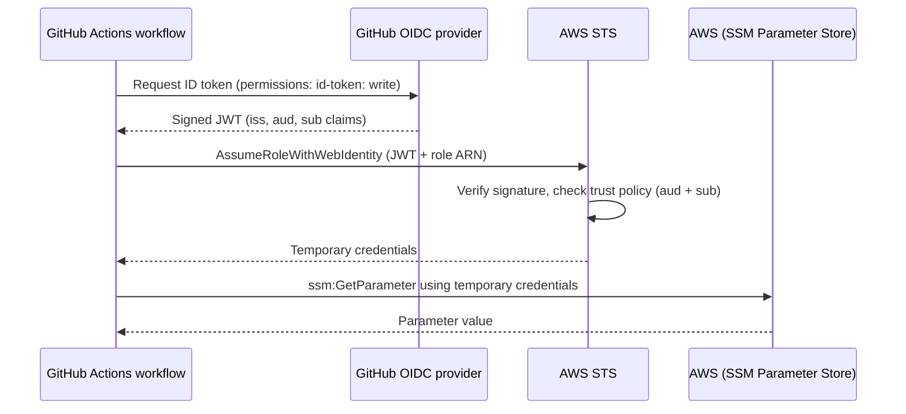

# GitHub Actions to AWS with OIDC (no stored access keys)

A GitHub Actions workflow that authenticates to AWS using OpenID Connect (OIDC) instead of long-lived access keys. GitHub issues a short-lived signed token for each run, AWS validates it against an IAM trust policy scoped to this repo and branch, and the workflow receives temporary credentials.

## Why this matters

Storing an AWS access key in GitHub Secrets creates a permanent credential that can leak, never expires, and can't be tied to a specific repo or branch. With OIDC:

- there are **no secrets to store or rotate**
- credentials are **temporary** (about an hour)
- access is **limited to one repo and branch** by the role's trust policy
- the same pattern is used for EKS pod identity (IRSA), SSO into tools like ArgoCD and Grafana, and workload identity across clouds

## Architecture



## Tech stack

GitHub Actions, AWS IAM (OIDC identity provider, role, trust policy), AWS STS, AWS Systems Manager Parameter Store

## How it works

1. **IAM OIDC provider** registered for `https://token.actions.githubusercontent.com` with audience `sts.amazonaws.com`.
2. **IAM role** with a trust policy that only accepts tokens whose `aud` is `sts.amazonaws.com` and whose `sub` matches this exact repo and the `main` branch.
3. **Least-privilege permissions:** the role can only run `ssm:GetParameter` on one named parameter.
4. **Workflow** requests the token (`id-token: write`), assumes the role with `aws-actions/configure-aws-credentials`, then reads the parameter and prints the assumed identity.

### Trust policy (placeholders shown)

```json
{
  "Version": "2012-10-17",
  "Statement": [
    {
      "Effect": "Allow",
      "Principal": {
        "Federated": "arn:aws:iam::<ACCOUNT_ID>:oidc-provider/token.actions.githubusercontent.com"
      },
      "Action": "sts:AssumeRoleWithWebIdentity",
      "Condition": {
        "StringEquals": {
          "token.actions.githubusercontent.com:aud": "sts.amazonaws.com",
          "token.actions.githubusercontent.com:sub": "repo:<OWNER>@<OWNER_ID>/<REPO>@<REPO_ID>:ref:refs/heads/main"
        }
      }
    }
  ]
}
```

### Permissions policy

```json
{
  "Version": "2012-10-17",
  "Statement": [
    {
      "Effect": "Allow",
      "Action": "ssm:GetParameter",
      "Resource": "arn:aws:ssm:us-east-1:<ACCOUNT_ID>:parameter/hello_aws-gh-oidc"
    }
  ]
}
```

## Troubleshooting: `Not authorized to perform sts:AssumeRoleWithWebIdentity`

### Symptom

The workflow failed at the "Configure AWS credentials" step. The action retried repeatedly ("Assuming role with OIDC" many times, over a minute) and ended with:

```
Error: Not authorized to perform sts:AssumeRoleWithWebIdentity
```

It also printed deprecation warnings from the older v2 action (AWS SDK for JavaScript v2 maintenance mode, `url.parse()`). Those were harmless and went away after upgrading to `aws-actions/configure-aws-credentials@v4`.

### Investigation

The trust policy looked right: correct provider ARN, correct `aud`, and a `sub` of `repo:<OWNER>/<REPO>:ref:refs/heads/main`. Rather than guess, I added a temporary workflow step that requests a token and prints its `iss`, `aud`, and `sub` claims (claims only, no secrets).

### Root cause

The `sub` claim GitHub actually sent included immutable numeric IDs for the owner and the repository:

| | Value |
|---|---|
| What my trust policy expected | `repo:<OWNER>/<REPO>:ref:refs/heads/main` |
| What GitHub sent | `repo:<OWNER>@<OWNER_ID>/<REPO>@<REPO_ID>:ref:refs/heads/main` |

Because the trust policy compares the string exactly, AWS rejected the token. GitHub includes the IDs so that an attacker cannot re-register a renamed or deleted account or repo name and inherit its cloud access.

### Fix

Updated the trust policy condition to the exact `sub` value printed by the debug step, using `StringEquals` with no wildcards. After re-running the workflow, the role assumed successfully and `aws sts get-caller-identity` showed the `assumed-role/...` ARN. I then removed the debug step.

### Takeaways

- Never hand-write the `sub` value: print the real token claims and copy from them.
- Keep the condition as strict as possible (exact repo and branch, no `*`).
- The `sub` changes with the trigger (branch push, pull request, environment), so a trust policy written for `main` will reject runs from other triggers by design.

## Running it yourself

1. Create the IAM OIDC provider and role as above (`terraform` version of this is a planned follow-up).
2. Create the SSM parameter:
   ```bash
   aws ssm put-parameter --name hello_aws-gh-oidc --type String --value "Hello from AWS via OIDC" --region us-east-1
   ```
3. Set `role-to-assume` in `.github/workflows/deploy.yml` to your role ARN.
4. Push to `main` and open the **Actions** tab.

## What I learned

- How OIDC, OAuth, and JWTs fit together and why a signed, short-lived token beats a stored key
- How to read a failed `AssumeRoleWithWebIdentity` by inspecting the token's claims instead of guessing
- How to scope an IAM role to one repo, one branch, and one API action

## Cleanup

Delete the SSM parameter, the IAM role, and the OIDC provider if you no longer need them. The role and provider are free, but removing unused trust relationships is good hygiene.